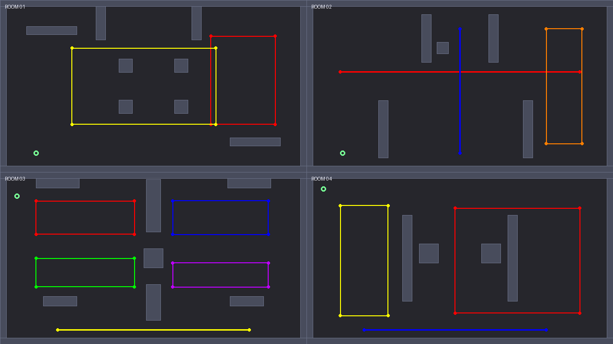

# Hue Massacre

> *Take back the bright, and paint the dark with light.*

A top-down stealth-action game where **colour theory is the weapon, the camouflage,
and the score.** Built in Godot 4 with GDScript for a university Colour Theory Game
assignment.

---

## Play it

| | |
|---|---|
| **Playable build** | `https://zeditya.github.io/hue-massacre/` |
| **AI chat history (PDF)** | `docs/AI_CHAT_HISTORY.pdf` |
| **Video walkthrough (20+ min)** | `[[PASTE YOUTUBE LINK HERE]]` |
| **Source** | `https://github.com/zeditya/hue-massacre` |

---

## 1. The pitch

The city is grey because the **Collectors** came in the night and drank the
rainbow out of sight. Every street is the same dead colour. Every guard is a
walking bottle of stolen hue.

You are the one small spark that still holds the red. You cannot shoot. You have
a blade, a short lunge, and the unfortunate advantage that **you are a colour in
a world of grey** — which means you are almost always visible.

So you take colours back the only way they can be taken: you kill a guard, the
colour splashes out of him and stains the floor, and then you go and *stand in
it*. Now the floor under you is your colour. Now the guard's eyes slide past you.

Colour is both halves of the game. It is how you hide, and it is how you kill.

---

## 2. How to play

You have no health bar and no gun. Everything is one hit.

- **Guards kill you on touch.** Any contact, any colour, instant death.
- **You kill guards with the lunge.** A short dash with a blade. Contact kills.
- Death costs you nothing but tempo: **the room restarts instantly**, with your
  combo reset (your score and the room number are kept).

The loop is: *watch the cone → pick your moment → lunge → take the colour →
hide in your own paint → repeat.*

### Controls

| Input | Action |
|---|---|
| **W A S D** or **Arrow keys** | Move — this also aims your light cone and your lunge |
| **Space** or **Left mouse button** | Lunge-dash the way you are steering (kills on contact) |
| **R** | Restart the current room immediately |
| **Esc** | Pause — Resume / Restart room / Quit to menu |
| **W / S** on a menu | Move the highlight; **Space / Enter / click** selects |

There is deliberately **no separate mouse aim.** The way you steer is the way you
face, the way you lunge, and the way your light cone points — one input, one
direction, so the keyboard never fights the mouse. A thin ring around the spark
fills back in as the lunge recharges.

### The shell: menu, story, pause

- **Start menu.** The game opens on a real, keyboard-driven menu — *Start game /
  How to play / Quit* — with a moving highlight, plus a strip of the whole hue
  wheel as the title graphic.
- **Story scene.** Choosing *Start* plays one held shot: the spark standing alone
  in the grey city, thinking *“We have to bring the colours back.”* before the
  five rhyming cards and the first room.
- **Pause.** **Esc** during play freezes the room and offers *Resume / Restart
  room / Quit to menu* — no more losing a run for tapping Esc.
- **Colour motes.** Every room hides a few drifting shards of stolen colour.
  Walk into one to **drink a whole hue** — a second, quieter way to move your
  colour on the wheel besides absorbing a guard, and a small light to steer by
  in the dark.

---

## 3. The colour theory, mechanic by mechanic

This is the grading core of the assignment, so each rule below names the real
principle it comes from and where it lives in the code. All hue maths is in
`scripts/color_theory.gd`.

### 3.1 Simultaneous contrast — *why standing in your own colour hides you*

A guard can only see you if you **contrast with the ground under your feet.**

This is the principle of *simultaneous contrast*: we perceive a colour relative to
its surroundings, not in isolation. The same bright red is blindingly obvious on
grey concrete and invisible on red concrete — the object did not change, the
*relationship* did.

In code: the guard compares your hue to the hue of the paint you are standing in.
If the gap is under **26°**, your contrast is essentially zero and the guard will
not see you, no matter how close you get.

```
standing on bare grey floor  -> contrast HIGH  -> spotted in ~0.45s
standing in paint of your hue -> contrast NIL   -> never spotted
standing in paint 90° away    -> contrast HIGH  -> spotted
```

**This is why the game starts tense.** Room 1 begins with two guards and no paint
anywhere, so you are a beacon on a grey floor until your first kill.

### 3.2 Hue difference on the wheel — *the measurement everything uses*

Every colour question in the game reduces to one function: **how far apart are
these two hues on the 360° colour wheel?**

```
hue_gap(a, b) = shortest angular distance between hue(a) and hue(b), 0..180
```

Godot's `Color.hue` returns 0.0–1.0, so it multiplies by 360. The "shortest"
part matters: hues are a circle, so red at 350° and orange at 10° are 20° apart,
not 340°.

The wheel positions are fixed and exact, and the test suite re-derives every one
of them from the RGB values to prove the constants are honest:

| Colour | RGB | Hue |
|---|---|---|
| Red | `(1.00, 0.00, 0.00)` | 0° |
| Orange | `(1.00, 0.50, 0.00)` | 30° |
| Yellow | `(1.00, 1.00, 0.00)` | 60° |
| Green | `(0.00, 1.00, 0.00)` | 120° |
| Blue | `(0.00, 0.00, 1.00)` | 240° |
| Purple | `(0.75, 0.00, 1.00)` | 285° |

### 3.3 Complementary contrast — *the combo system*

Two hues **180° apart** are complements. Placed together they vibrate; each makes
the other look more intense. In this game they cancel: a complement pair is a
**cancellation**, and that is worth points.

Kill two guards whose hues are within **25° of exactly 180° apart**, within
**3 seconds** of each other, and you trigger a **combo**: the screen flashes
white (two complementary colours average to white), the camera kicks, and your
score multiplier climbs (x2, x3, up to x8 with a long enough chain).

The pairs that exist in the game are deliberate:

| Pair | Gap | Combo? |
|---|---|---|
| Yellow (60°) ↔ Blue (240°) | 180° | **Yes** — exact |
| Green (120°) ↔ Purple (285°) | 165° | **Yes** — 15° off |
| Orange (30°) ↔ Blue (240°) | 150° | **No** — 30° off |
| Red (0°) ↔ (nothing) | — | **No** |

Those last two rows are the actual lesson. "Opposite on the wheel" is a **measured
relationship, not a vibe** — and Room 2 is deliberately built so that you *cannot*
combo by accident, because Orange and Blue look dramatic together but are 30°
short of true complementary.

### 3.4 Additive hue blending — *colour mixing on the wheel*

When you kill a guard you **absorb** his colour: your new hue is blended 50%
toward his, through the **shortest arc** on the wheel.

```
hue_new = hue_old + hue_gap_signed(hue_old, hue_his) * blend
```

Blending through the shortest arc is what makes it feel like real paint. Red +
Blue averages the long way around to Yellow (the naive `mix()` answer, and it
looks wrong) or the short way to **Violet**, which is what red and blue actually
make. Room 2 is built around this: the Red and Blue guards patrol across each
other at exactly one point, so their two puddles overlap and average to Violet —
and so do you.

This is also why the **boss room is not a soft-lock**. You rotate your own hue by
choosing which guard to absorb, which moves the complement you are hunting for.

### 3.5 Complementary cancellation — *the boss*

The Collector is a large guard whose hue **rotates continuously** around the wheel
at 28°/s — a full lap in about 13 seconds. He is invulnerable, except in the
**1.8-second window** each lap when *his* hue is within 25° of *your* complement.

The wheel bar in the HUD shows where he is. You have to manage two colours at once
(your hue and his) while he hunts you. Lunging outside the window kills you
instead.

---

## 4. Content

Four rooms, in order, each teaching exactly one idea:

| Room | Lesson | What it teaches |
|---|---|---|
| **01 — MATCHING** | Simultaneous contrast | Kill, stand in the paint of your own hue, and hide. An open plaza with a colonnade and almost no real cover — until you paint some. |
| **02 — MIXING** | Additive hue blending | A horizontal lane and a vertical lane crossing at one point. Overlap the two puddles there to make Violet — and make yourself Violet. |
| **03 — COMPLEMENTS** | Complementary contrast | Five guards including two true complement pairs. Land Yellow→Blue or Green→Purple inside 3s for the multiplier. |
| **04 — THE COLLECTOR** | Complementary cancellation | The boss. Hue rotates; you may only cut him on his complement. Two small guards exist so you can shift your own hue. |

Rooms are plain data in `scripts/level_data.gd` — no scene files to click around
in. Clearing all guards completes a room; the floor's **"restored" bar** fills as
your paint covers the level, and clearing the boss room wins.

Each room is a **different kind of space**, and the architecture is doing work:
Room 1 is an open plaza (you are exposed, so paint is your only cover), Room 2 is
two crossing lanes (the junction is where mixing happens), Room 3 is split into
wings by a broken central spine with two doorways, and Room 4 is an arena with a
central lane and cover blocks. Guard routes are authored against this geometry,
and the test suite re-measures every route against every wall, so a layout that
traps a guard simply fails the build.



*All four floor plans. Grey blocks are walls; the coloured lines are the guard
patrol routes (each drawn in that guard's own hue); the green ring is the
player's spawn.*

### Score

| Event | Points |
|---|---|
| Guard killed | 100 × multiplier |
| The Collector | +1000 |
| Room cleared without ever being spotted | +500 |

Your final **rank** (S / A / B / C / D) is derived from your deaths on the win
screen — an S is a deathless run, and only the deaths move it.

---

## 5. Project structure

```
res://
├─ project.godot          main scene + input map + renderer
├─ export_presets.cfg     Web export preset (single-threaded)
├─ LICENSE                MIT — covers the code, NOT the art in assets/
├─ docs/                  assignment artefacts (AI chat history PDF, floor plans)
├─ assets/
│  ├─ characters/
│  │  └─ adventurer/      free top-down character sheets
│  ├─ tiles/
│  │  └─ room_builder_16x16.png   floor tiles (Modern Interiors — non-commercial)
│  ├─ LICENSES/           the licence text for each art pack
│  └─ ATTRIBUTION.md      where every asset came from, and its terms
├─ scenes/
│  └─ main.tscn           the ONLY scene in the game: one Node + game.gd
├─ scripts/
│  ├─ game.gd             the conductor: state machine, score, combo, shake, flash
│  ├─ color_theory.gd     ALL the hue maths (gaps, complements, blending, contrast)
│  ├─ level_data.gd       all 4 rooms as plain dictionaries — the whole level design
│  ├─ room.gd             builds a room from its dictionary, runs the rules
│  ├─ player.gd           movement, lunge dash, colour absorption
│  ├─ guard.gd            patrol / investigate / chase, vision cone, boss rotation
│  ├─ paint_layer.gd      splatters, fading, "what colour is the floor here?"
│  ├─ mote.gd             floating colour shards you can drink for a whole hue
│  ├─ tile_bank.gd        bakes the tiled floor into one ImageTexture
│  ├─ sprite_bank.gd      slices the character sheets into SpriteFrames
│  ├─ hue_tint.gdshader   recolours a character to ANY hue (colour theory on art)
│  ├─ darkness.gdshader   the dark city: the spark's light cone + guard lanterns
│  └─ audio_bank.gd       procedural sound effects (no audio files needed)
├─ ui/
│  ├─ ui_style.gd         fonts + themed colours in one place
│  ├─ hud.gd              score, combo, your colour swatch, restored bar, boss wheel
│  └─ screens.gd          start menu, story scene, intro cards, pause, death, win
├─ tests/
│  ├─ test_runner.gd      179 automated checks
│  └─ test_runner.tscn    tiny scene to run them
└─ tools/
   └─ make_input_map.gd   one-off generator for project.godot's input map
```

**Almost nothing is built in the editor.** The game is one scene containing one
node; everything else — the rooms, the guards, the player, the HUD, the menus — is
constructed in code at runtime. The world, the UI and the effects are drawn with
`_draw()`, and every sound is synthesised procedurally, so there are no audio
files to ship.

The one imported asset is the character art. A single free top-down sprite pack
(credited in `assets/ATTRIBUTION.md`) is sliced into animations by
`scripts/sprite_bank.gd` and recoloured to *any* hue by
`scripts/hue_tint.gdshader`, so the same figure becomes the player or any of the
six guard colours. That keeps the "everything is a colour" idea intact even
though the artwork ships with its own fixed palette.

The floor is the second imported asset: `scripts/tile_bank.gd` bakes the tiled
"Modern Interiors" floor into a single 1280×720 texture, darkened until its
average colour *is* `ColorTheory.FLOOR_GREY`. So the drained world gains real
texture without the picture ever disagreeing with the colour rules. Building the
rest in code makes the project impossible to break by mis-clicking in the editor.

### Tunable values

Every number worth changing is an `@export` at the top of its script, grouped, so
it can be tweaked live in the editor. The ones you are most likely to want:

| Value | Script | Default |
|---|---|---|
| `hide_tolerance_deg` | `player.gd`, `guard.gd`, `game.gd` | 26° |
| `complement_tolerance_deg` | `game.gd` | 25° |
| `combo_window` | `game.gd` | 3.0s |
| `boss_kill_tolerance_deg` | `game.gd` | 25° |
| `dash_speed` / `dash_cooldown` | `player.gd` | 820 / 0.50s |
| `cone_length` / `cone_angle_deg` | `guard.gd` | 310px / 64° |
| `detect_time` | `guard.gd` | 0.45s |
| `blob_lifetime` | `paint_layer.gd` | 10.0s |
| `absorb_amount` | `player.gd` | 0.5 (50% blend) |
| `hue_speed` | boss entry in `level_data.gd` | 28°/s |
| `darkness_amount` | `game.gd` | 0.55 (1.0 = pitch black) |
| `light_cone_deg` / `light_range` | `game.gd` | 62° / 640px |
| `guard_lantern_range` | `game.gd` | 190px |

The whole atmosphere is tunable in one place: set `darkness_enabled` to `false` in
`game.gd` to play the bright, unlit version the game started as.

---

## 6. Build and run

Full instructions, including web export and hosting, are in **[HOW_TO_RUN.md](HOW_TO_RUN.md)**.
The short version:

1. Install **Godot 4.7** (standard build, not .NET) from <https://godotengine.org/download>.
2. **Import** → select this folder's `project.godot`.
3. Press **F5**.

No assets to download, no addons to enable, no configuration required.

---

## 7. Typography and UI

The UI is themed, not default-grey. `ui/ui_style.gd` holds the type scale and the
palette in one place; `ui/hud.gd` and `ui/screens.gd` use it.

- **Display text** (titles, room names, the win screen) is heavy, wide-tracked, and
  set in a warm gold — the "returned light" colour.
- **Body text** (hints, controls, the story cards) is smaller, high-contrast, and
  cool grey so it reads against the dark world without competing with the display.
- **Colour-aware text.** The combo readout is drawn in the *complement of the
  current floor colour*, so the score literally demonstrates complementary contrast
  while you play. The player's own swatch is labelled with its **hue name**
  (RED / VIOLET / SPRING…), so the HSV measurement is legible mid-run rather
  than hidden inside a number.
- **Story cards.** Each of the five intro couplets fades in, and the **last word of
  each couplet is drawn in that line's own colour** — `dead` in red, `sight` in
  blue, and so on — so the typography itself teaches the colour wheel.

### The dark city

The drained world is dim, and the only light is colour. `scripts/darkness.gdshader`
lays a semi-transparent night over the world (above the game, below the HUD) and
cuts it open in three places:

- a **light cone** in front of the spark, pointing wherever WASD steers;
- a soft **ambient pool** around the spark, so the ground you are standing on is
  always readable — the dark is atmosphere, never an obstacle;
- a **lantern pool** around every guard, tinted with the colour that guard stole,
  so threats read as pools of light at the edge of your vision.

It is deliberately gentle (default `darkness_amount = 0.55`) and fully tunable in
`game.gd`; the shader falls back to a transparent overlay, so even a shader failure
cannot black out the screen.

Fonts: the project uses Godot's built-in default font, styled with themed colours
and sizes, so there is **no font file to download or place**. (If you want a pixel
font later, see the note at the end of HOW_TO_RUN.md.)

---

## 8. Audio

There are **no audio files in this repo.** `scripts/audio_bank.gd` synthesises
every sound effect procedurally at runtime — the blade lunge, the splat, the combo
chime, death, the boss window opening. It builds each one as a short burst of
generated samples played through a small pool of `AudioStreamPlayer`s.

Two consequences worth knowing:

- Nothing to license, nothing to credit, no missing-file errors.
- **Browsers block audio until the player interacts with the page.** In the web
  build, sound starts after your first keypress or click (including the click on
  the intro screen). Nothing is broken if the first second is silent.

---

## 9. AI usage statement

This project was built with an AI coding agent (this is required to be disclosed).

- **All code** in `scripts/`, `ui/`, `tests/`, and `tools/` was written with AI
  assistance, from a design brief I wrote.
- **All design decisions** — the colour-theory mapping, the room layouts, the
  difficulty curve, the story text — came from the brief; the AI implemented them.
- **The AI did the arithmetic and the testing.** The six guard hues, the
  complement gaps, and the room geometry were all derived and then *verified* by
  the automated suite in `tests/`, which is why the comment in `level_data.gd`
  can claim exact hue values rather than approximate ones.
- **I have read and understood every file.** The code is heavily commented in
  plain language specifically so that it can be explained line by line in the
  video, and I can justify any part of it.
- The full chat history is merged into `docs/AI_CHAT_HISTORY.pdf` (selectable
  text, not screenshots) — link at the top of this README.

---

## 10. Honest limitations

Things that are **not** verified, stated plainly:

- **The AI could not see the game render** through the automated suite. The build
  is verified by compiling and by **179 automated logic tests** run in a *headless*
  engine, which does not execute `_draw()`. So: the rules, the maths, the state
  machine, the room geometry and the win/lose flow are all machine-verified. The
  **visual output was checked by rendering frames during development**, but no
  automated test can judge it, so treat the first playthrough as the real art check.
- **Colour mixing blends hue only.** Saturation and value are mostly preserved
  rather than properly blended, so mixing two dark colours does not darken them
  the way real pigment would. This is a deliberate simplification for clarity.

See [TESTING.md](TESTING.md) for the full list of what was and was not tested.
